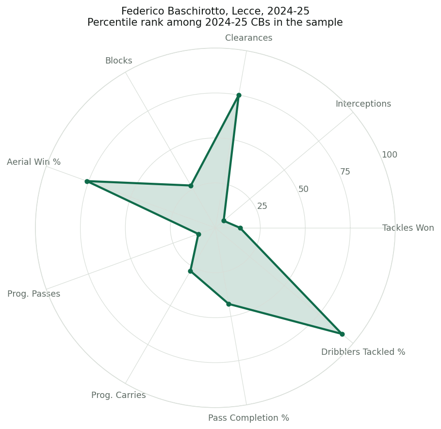
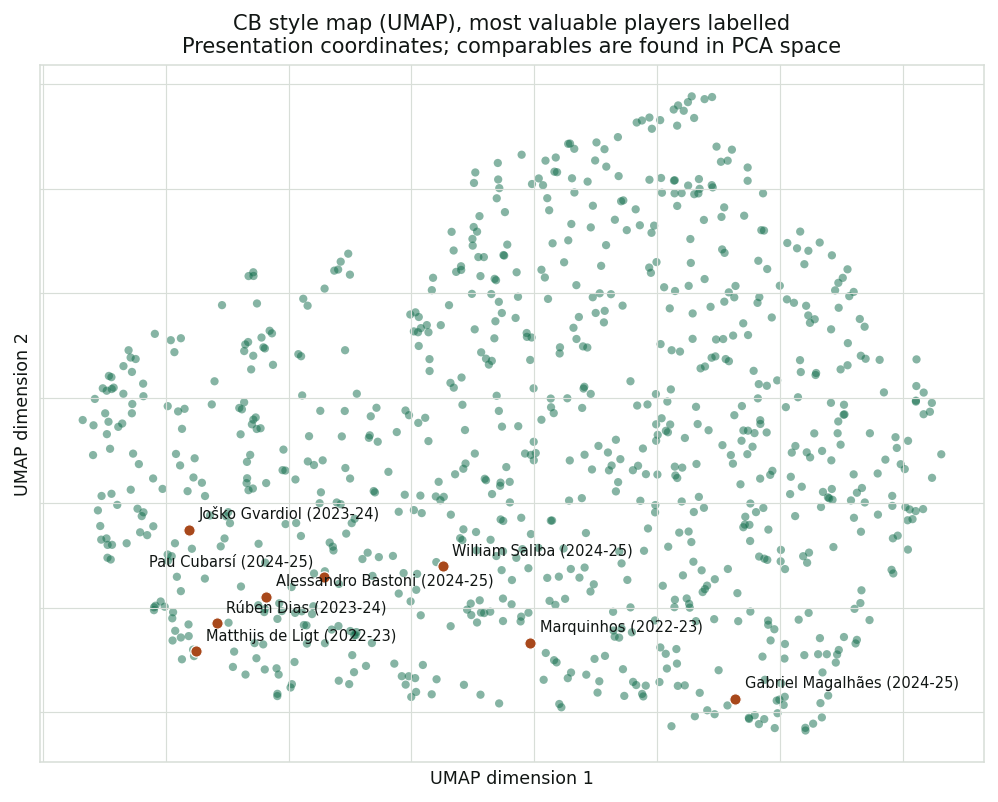
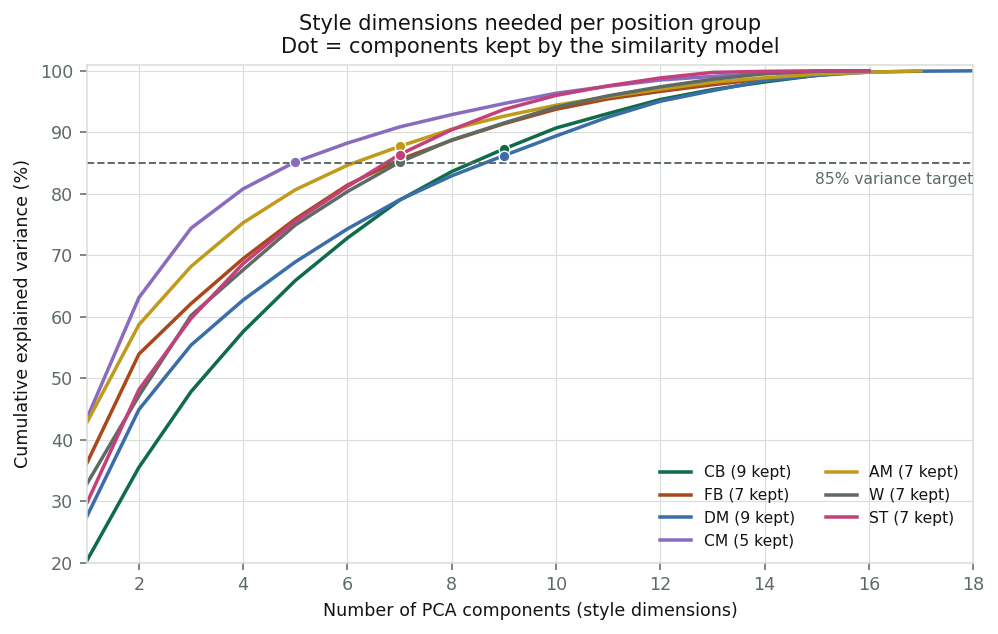
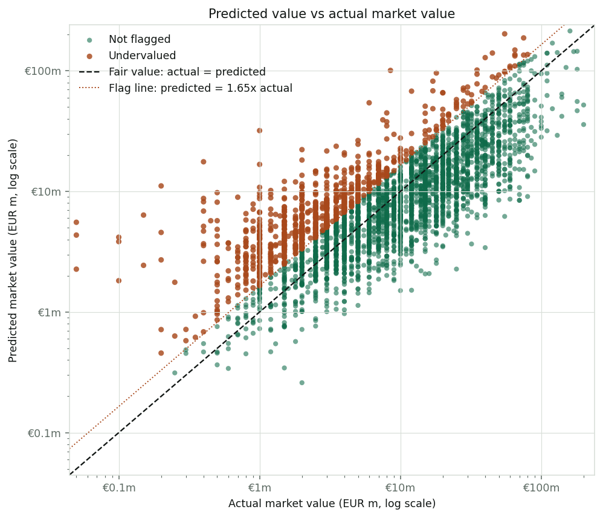

# Player Recruitment & Similarity Tool

Find players who play like the one you are losing, across Europe's five big leagues, and see which of them the market prices below their profile.

**Live app:** _link added after deployment to Streamlit Community Cloud_

<p align="center">
  
</p>

|                         |                                                                                                                                   |
| ----------------------- | --------------------------------------------------------------------------------------------------------------------------------- |
| **Comparables**   | Cosine nearest neighbours on PCA style scores, within position group                                                              |
| **Style profile** | Percentile radar against the same position group and season                                                                       |
| **Playing role**  | Best-fit role per player-season - Deep-lying playmaker, Overlapping wing-back, False 9 - from hand-picked stat profiles           |
| **Value flag**    | Out-of-fold residual from an expected-market-value model                                                                          |
| **Filters**       | Position, role, season, candidate seasons, leagues, age, budget range, minutes                                                    |
| **Data**          | 3,768 player-seasons: Premier League, La Liga, Serie A, Bundesliga, and Ligue 1 in 2022-23 and 2024-25; Premier League only in 2023-24 |

### Headline results

- A player's own **next season ranks in the top 3.3% of his position group** (median rank 19th) - a random model would put it in the middle, at 50%.
- Every player-season gets a **playing role** in football language, and it carries into his next season **59% of the time, against 28% by chance**.
- Players flagged **undervalued in 2022-23 were worth 1.06x their value two years later**, against 0.60x for the rest, and the gap holds inside every age band.
- Expected market value is predicted to a **median error of 45%**, on cross-validation grouped by player.

---

## Case study: replacing a left-back

> _A mid-table Premier League side has lost its first-choice left-back. They need a replacement under 23, a budget of €8m, and the same profile: high volume overlapping runs, crossing from the byline rather than inverting into midfield._

The template is **Antonee Robinson** (Fulham, 2024-25), an overlapping left-back at a mid-table club: 86th percentile for crosses, 94th for progressive carries and for tackles plus interceptions, 86th for touches in the attacking third.

**Filters:** position FB · candidate seasons 2024-25 · budget €0-8m · age 23 or under · 900+ minutes. Ranks are among all 676 full-back seasons, as the app shows them.

Robinson is an **Overlapping wing-back** in 2023-24 and 2024-25 (a Full-back in 2022-23, when he created less), and so is every candidate below, so adding the app's role filter (Overlapping wing-back) leaves the shortlist unchanged: the brief and the role vocabulary agree.

| Rank | Player          | Club      | Age | Foot  | Value  | Model   | Contract | Similarity |
| ---- | --------------- | --------- | --- | ----- | ------ | ------- | -------- | ---------- |
| 170  | Álex Jiménez  | Milan     | 19  | right | €5.0m | €6.1m  | 3.5 yrs  | 0.43       |
| 188  | Nathaniel Brown | Frankfurt | 21  | left  | €8.0m | €15.5m | 5.5 yrs  | 0.38       |

The first finding is negative, and worth stating: **nobody in that pool is close to Robinson.** The best similarity is 0.43, where his true peers sit above 0.9. Under-23 full-backs on €8m rarely carry, tackle and cross at his volume at the same time. Two candidates survive the filters, and one is discarded straight away:

- **Álex Jiménez - discarded.** Right-footed, and a wing-back who carries (97th percentile) far more than he crosses (54th): he drives the ball forward rather than delivering it from the byline.
- **Nathaniel Brown - the one to scout.** Left-footed, five and a half years of contract, and close on the end product that defines the role: crosses 82nd percentile, xA 94th, key passes 93rd, tackles plus interceptions 85th. He carries less (64th) and beats his man less often (take-on success 23rd), so he delivers from the byline after the ball reaches him rather than driving it there himself. The model values him at €15.5m against a €8m market value; Transfermarkt had him at €22m by July 2025.

**What goes to the scout:** player to scout is Nathaniel Brown from Frankfurt. Statwise the player looks similar to Antonee Robinson. There are a few things that the metrics can't quantify such as his work rate and if he is used to playing similarly to how we play at the club tactically. Also important to reach out to his agent about transfer, to get an idea of how much would the fee and salary be.

### Hindsight check: the same brief in 2023

Running the identical brief on the 2022-23 pool shows what the shortlist was worth two seasons later.

| Rank | Player            | Club      | Foot  | Value 2022-23 | Value July 2025 | Verdict                              |
| ---- | ----------------- | --------- | ----- | ------------- | --------------- | ------------------------------------ |
| 20   | Issa Kaboré      | Marseille | right | €5.0m        | €4.0m          | Discarded: wrong foot                |
| 32   | Yan Couto         | Girona    | right | €6.0m        | €20.0m         | Discarded: wrong foot (a right-back) |
| 87   | Miguel Gutiérrez | Girona    | left  | €8.0m        | €20.0m         | **Shortlist**                  |
| 93   | Quentin Merlin    | Nantes    | left  | €7.0m        | €15.0m         | **Shortlist**                  |
| 141  | Hugo Bueno        | Wolves    | left  | €0.2m        | €8.0m          | Shortlist (flagged undervalued)      |

The highest-ranked candidate was the wrong answer for reasons the similarity score cannot see - a right-footer - and the two left-footers below him more than doubled in value. That is the point of the tool: it narrows 676 full-backs to a handful worth watching, and the judgement on that handful is still a person's.

---

## How it works

### Data

| Source                                                                      | Via                                                                                                                    | What it gives                                              |
| --------------------------------------------------------------------------- | ---------------------------------------------------------------------------------------------------------------------- | ---------------------------------------------------------- |
| [FBref](https://fbref.com)                                                   | [`soccerdata`](https://soccerdata.readthedocs.io/)                                                                    | Player list, basic stats, team possession                  |
| FBref, archived                                                             | [Wayback Machine](https://web.archive.org/) copies                                                                      | The advanced (Opta) stats FBref no longer serves           |
| FBref, Kaggle copy                                                          | [Football Players Stats (2024-2025)](https://www.kaggle.com/datasets/hubertsidorowicz/football-players-stats-2024-2025) | 2024-25 aerial duels and ball recoveries the archive lacks |
| [transfermarkt-datasets](https://github.com/dcaribou/transfermarkt-datasets) | direct download                                                                                                        | Market values, sub-positions, transfers, appearances       |
| transfermarkt-datasets, raw scrapes                                         | its public DVC store                                                                                                   | Contract end dates as they stood during each season        |

Nothing is scraped from Transfermarkt directly: the project uses dcaribou's already-scraped, versioned release.

**FBref lost its advanced stats on 2026-01-20**, when its Opta agreement ended. [`src/fetch_fbref_archive.py`](src/fetch_fbref_archive.py) recovers
them from Wayback Machine copies of the same pages taken before that date, each pinned by capture timestamp in
[`data/fbref_archive_snapshots.csv`](data/fbref_archive_snapshots.csv). The archive holds all of 2022-23 and 2024-25 but only the Premier League in
2023-24, and a player-season enters the model only if it has every advanced stat page - filling whole missing pages with medians would invent profiles.

**Gaps filled from Kaggle, after checking it.** The archive keeps FBref's miscellaneous page (aerial duels, ball recoveries) for only two leagues in 2024-25. The other three come from a Kaggle copy of FBref scraped before the
removal ([`src/fetch_kaggle.py`](src/fetch_kaggle.py)). It only fills empty cells, and is used only because it matched the archive value-for-value on
every compared column across all 2,852 player-seasons (`reports/fbref_kaggle_check.csv`).

**Contracts as they stood at the time.** The released Transfermarkt table holds only each player's *current* contract, which is wrong for every past season - a player who has since extended looks as if he had years more left. On this data it put the average 2023-24 player at 4.4 years remaining against 2.8 from dated records. [`src/fetch_tm_contracts.py`](src/fetch_tm_contracts.py) instead reads seven of the dataset's raw scrapes (May 2023 to July 2026), each a dated snapshot of every player's contract, and takes the one nearest each season's midpoint, provided the player stayed at the same club in between. 88% of model rows get a dated contract; the rest are left blank rather than guessed.

**The name join is checked against where players actually played.** Matching on name and birth year alone confuses namesakes - two Adama Traorés, two Vitinhas - and fuzzy matching scores "Rodri" 100 against "Rodri Tarín".
Every match is therefore confirmed against Transfermarkt's appearances: the player must have played for that club that season, or the right player is found within the squad. 96.0% of players match; the club check corrected 52 player-seasons (Rodri had been a €1m centre-back), recovered 80 that failed on nicknames (Andy/Andrew Robertson), and unlinked 6 it could not confirm. Every change is in `reports/name_match_club_check.csv`.

### Position groups and features

Seven groups - `CB`, `FB`, `DM`, `CM`, `AM`, `W`, `ST` - from Transfermarkt's sub-positions, because FBref's own `DF / MF / FW` cannot tell a centre-back from a full-back. Each group has its own 16-18 stats ([`src/config.py`](src/config.py)), and its radar shows 8-9 of them, chosen by hand. Stats where a high number is bad (fouls, errors, miscontrols) can shape the comparables but never appear on a radar, where a 90th percentile would read as a strength. Goalkeepers are out of scope.

Two adjustments that are easy to skip:

- **Possession adjustment.** A midfielder whose team has 65% of the ball makes fewer tackles because the ball is not there to win. Defensive per-90s are scaled to a neutral 50%; without it, a "best ball-winner" list is a list of players at bad teams.
- **Volume and efficiency side by side** - take-ons attempted *and* success rate, aerials won *and* aerial win %. Style lives in the gap between them.

### Similarity

Each group's stats are standardised and reduced with PCA, keeping enough components for 85% of the variance (5 to 9), and comparables are the nearest neighbours by **cosine** distance on those scores.

- **Cosine, not Euclidean.** Cosine compares the *shape* of a profile and largely ignores its magnitude - which is what "plays like him" means. Euclidean blends style with level, and returns the same few elite players as comparables for everybody.
- **Search in PCA space, plot in UMAP space.** The app's style map is UMAP, which draws a far more readable picture, but the search never runs there: UMAP distorts global distances, so they carry no meaning.
- **A deep neighbour list.** 200 neighbours are stored per player, and the app shows the 25 closest that survive its filters. With only 25 stored, a brief like the one above left 95% of players with fewer than five candidates.

<p align="center">
  
</p>

_Centre-backs in two dimensions. The ball-playing CBs of possession sides (Gvardiol, Dias, Bastoni) gather in the lower left; the picture is for reading, and the neighbour search runs in PCA space._

#### Style dimensions _(draft names - read `reports/pca_loadings.csv` and rename in your own words)_

| Group | PC1                           | PC2                                                                   | PC3                                   |
| ----- | ----------------------------- | --------------------------------------------------------------------- | ------------------------------------- |
| CB    | Ball-playing volume           | Box defender (blocks, clearances, aerial %) vs front-foot ball-winner | Aggressive duel-winner vs long passer |
| FB    | Attacking involvement         | Ball-carrier vs crosser                                               | Defensive security vs dribbling       |
| DM    | Deep playmaking volume        | Destroyer vs progressor                                               | Aerial stopper vs ball recoverer      |
| CM    | Progression volume            | Deep controller vs final-third creator                                | Ball-carrier vs passer-creator        |
| AM    | Chance creation               | Passer vs dribbler                                                    | Box presence vs dribbler              |
| W     | Direct, box-attacking carrier | Crosser-creator vs dribbler                                           | Inside forward (shooter) vs dribbler  |
| ST    | Box-finishing volume          | Link-up forward vs penalty-box striker                                | Target man vs efficient finisher      |

<p align="center">
  
</p>

_How many style dimensions each group needs to reach 85% of its variance: central midfield compresses into 5, centre-backs and defensive midfielders need 9._

### Playing roles

Comparables answer "who plays like him?", but a brief is usually written as a role: "we need a deep-lying playmaker". Each group has three or four roles, defined by hand in `config.ROLES` as the stats whose high, low or middling percentile counts for the role.

| Group | Roles                                                                          |
| ----- | ------------------------------------------------------------------------------ |
| CB    | Ball-playing CB · No-nonsense CB · CB · Wide CB                             |
| FB    | Overlapping wing-back · Inverted full-back · Full-back                       |
| DM    | Ball-winner · Deep-lying playmaker · Half-back · Anchor                     |
| CM    | Box-to-box · Midfield playmaker · Deep-lying playmaker · Advanced playmaker |
| AM    | Second striker · Advanced playmaker · Channel midfielder                     |
| W     | Traditional winger · Inside forward · Wide playmaker · 1v1 dribbler         |
| ST    | Poacher · Target man · False 9 · Channel runner                             |

- **Scores, not clusters.** Clustering the midfielders' style scores was tried first: the clusters split players at dominant teams from everyone else - volume, not style - and a third of players sat on a boundary. A role score instead averages its stats' percentiles (a "low" stat counts as 100 minus its percentile; the plain CB's passing counts for being near the median) and ranks that average again within group and season, so every role shares one 0-100 scale.
- **Ratios where a role is about balance.** Some roles are defined by *how* a player contributes rather than how much, and raw per-90 counts would reward volume instead. Two ratios cover this: pass share of progression (progressive passes ÷ progressive passes + carries), which marks out the midfield playmaker who carries the ball forward rather than passing it, and shot share of threat (npxG ÷ npxG + xA), which separates the second striker who shoots from the advanced playmaker who creates.
- **Shares where a role is about position.** A half-back and an anchor both pass short; what separates them is where they take the ball - the half-back drops in like a centre-back of a back three, the anchor screens in front of the back line. Raw zone touches grow with a team's possession, so shares of total touches (own box, defensive third, middle third, opposition box) are used instead.
- **Volume adjusted for possession.** A metronome is defined by how much of the ball he has, but a midfielder at a 68% possession side has more of it whatever his style: the CM deep-lying playmaker's score correlated +0.56 with team possession. Its passes, touches and passes received are scaled to a neutral 50% (the mirror of the defensive adjustment), and both deep-lying playmakers count mistakes per touch rather than per 90, which cut the correlation to +0.36.
- **Hybrids.** A player whose second-best role is within 5 points of his best gets both ("Box-to-box / Advanced playmaker") - 18% of player-seasons.
- **A label and a filter, never a model input.** The neighbour search does not see roles; the app shows each player's role and lets the candidate pool be filtered by it.

Declan Rice shows what it picks up: a Deep-lying playmaker at West Ham in 2022-23 and at Arsenal in 2023-24, then Box-to-box / Advanced playmaker in 2024-25, the season he played further forward on the left of the midfield.

### Value model

Predicts each player-season's Transfermarkt value from age (as a spline - value peaks in the mid-twenties, which a straight line cannot represent), minutes, contract years remaining, league, position group, season and thirteen per-90 output stats.

- **Fitted on log value.** Values run from €50k to €200m and are close to log-normal; on raw euros a handful of superstars dominate the loss and every prediction under €5m becomes noise - exactly the range recruitment cares about.
- **Cross-validated grouped by player.** The same player appears in several seasons, and ordinary k-fold would let his 2022-23 row help predict his 2024-25 row.
- **Two candidates, the simpler one kept.** A Ridge baseline and gradient boosting are scored on the same folds and finish level, so the readable model wins.
- **The flag uses out-of-fold predictions.** A player is undervalued when his market value sits at least 1.65x below the prediction. In-sample predictions would shrink every residual and hide exactly the players the flag exists to find.

<p align="center">
  
  
</p>

_Left: the age curve the model learned - value peaks at 25 without anyone telling it to._

_Right: predicted against actual value; players above the dotted line (predicted at least 1.65x actual) are flagged undervalued._

---

## Validation

Every number here is produced by [`notebooks/validation.ipynb`](notebooks/validation.ipynb).

| Check                                                                 | Result                                   |
| --------------------------------------------------------------------- | ---------------------------------------- |
| Player-seasons in the model                                           | 3,768 (smallest group: AM, 263)          |
| Name match rate, FBref → Transfermarkt                               | 96.0%                                    |
| Market value / Transfermarkt position / dated contract                | 99.5% / 99.7% / 88% of rows              |
| Own next season, median rank in group                                 | 19th - top 3.3% (random: 50%)            |
| Own next season inside the group's top 5%                             | 58.8%                                    |
| Value model, median absolute error (grouped CV)                       | 45.0% (€3.4m)                           |
| Value model, R² on log value                                         | 0.61                                     |
| Top-5 comparables kept when the pool tightens from 600 to 900 minutes | 4.4 of 5                                 |
| Same playing role next season                                         | 59% (70% counting hybrids) - chance: 28% |

### Self-consistency

The same player a season later is the best comparable there is, so the closer he ranks to himself, the more the model captured the player rather than his team. Ranks are computed exactly for all 2,261 player-seasons with another season in the same group.

| Seasons apart | Player-seasons | Median rank | Median, as share of group | In the group's top 5% |
| ------------- | -------------- | ----------- | ------------------------- | --------------------- |
| 1             | 583            | 19          | 3.3%                      | 58.8%                 |
| 2             | 1,678          | 68.5        | 11.8%                     | 32.7%                 |

Two seasons apart is a much harder test - players change roles, clubs and systems - and most of the sample is two seasons apart, because 2023-24 is only available for the Premier League.

### Role stability

A role describes how a player plays, so it should mostly survive into his next season. Pairs are a player's consecutive seasons in the same group; "chance" is the agreement expected if roles were dealt at random in the observed proportions.

| Group         | Pairs | Roles | Same role | Counting hybrids | Chance | Lift |
| ------------- | ----- | ----- | --------- | ---------------- | ------ | ---- |
| CB            | 298   | 4     | 52%       | 64%              | 26%    | 2.0x |
| FB            | 244   | 3     | 60%       | 70%              | 35%    | 1.7x |
| DM            | 120   | 4     | 61%       | 69%              | 26%    | 2.3x |
| CM            | 204   | 4     | 60%       | 73%              | 26%    | 2.3x |
| AM            | 93    | 3     | 68%       | 76%              | 35%    | 2.0x |
| W             | 165   | 4     | 61%       | 74%              | 27%    | 2.2x |
| ST            | 157   | 4     | 58%       | 73%              | 25%    | 2.3x |
| **All** | 1,281 |       | 59%       | 70%              | 28%    | 2.1x |

Every group sits 1.7 to 2.3 times above chance ("lift": same role ÷ chance). DM was the least stable group under the first role set (1.8x) and is now among the most stable, since its half-back and anchor are told apart by where they take the ball rather than by how much of it they get. FB is the lowest relative to chance: with three roles, one of them covering 42% of regulars, chance agreement is already 35%. For the eye test, [`reports/role_top_players.csv`](reports/role_top_players.csv) lists the top five regulars per role and season - in 2024-25 Kimmich and Locatelli lead the deep-lying playmakers at DM, Tchouaméni the half-backs, Sano and Casado the anchors, Doku and Yamal the 1v1 dribblers, Díaz and Salah the inside forwards, and Stuani and Emegha the poachers.

### Does the undervalued flag mean anything?

For every 2022-23 player-season, the market value the model saw is compared with the player's last valuation before July 2025, split by age because young players rise regardless.

| Age                          | Flagged: median value change | Flagged: share that rose | Not flagged: median | Not flagged: share that rose |
| ---------------------------- | ---------------------------- | ------------------------ | ------------------- | ---------------------------- |
| 22 or under                  | 4.75x                        | 92%                      | 1.40x               | 68%                          |
| 23-26                        | 1.45x                        | 65%                      | 0.84x               | 39%                          |
| 27-29                        | 0.75x                        | 36%                      | 0.48x               | 10%                          |
| 30+                          | 0.50x                        | 9%                       | 0.33x               | 2%                           |
| All (327 flagged, 1,132 not) | 1.06x                        | 50%                      | 0.60x               | 26%                          |

Flagged players did better in every age band. Part of what the flag catches is Transfermarkt lagging behind breakthrough seasons (Evan Ferguson at €1m, Rico Lewis at €1m in 2022-23) - genuinely useful to a recruiter, but not the same as knowing something the market cannot. Players no longer valued in 2025 are left out.

### Known transfers

Would the model have surfaced real replacement signings as comparables to the player they replaced? Ranks are exact, among everyone in the group.

| Departed                              | Replacement | Rank before the move | Note                                      |
| ------------------------------------- | ----------- | -------------------- | ----------------------------------------- |
| De Bruyne (Man City, 2024-25)         | Cherki      | 12 of 263            | Top 5%                                    |
| Gündoğan (Man City, 2022-23)        | Kovačić   | 48 of 599            | Top 8%                                    |
| Partey (Arsenal, 2024-25)             | Zubimendi   | 59 of 345            | Top 17%                                   |
| Alexander-Arnold (Liverpool, 2024-25) | Frimpong    | 167 of 676           | A deliberately different profile          |
| Fabinho (Liverpool, 2022-23)          | Endo        | 254 of 345           | **1st** once at Liverpool (2023-24) |
| Benzema (Real Madrid, 2022-23)        | Joselu      | 325 of 535           | A squad striker, not a like-for-like      |
| Xhaka (Arsenal, 2022-23)              | Rice        | -                    | Different position groups                 |

Only one replacement was a top-25 comparable *before* the move: Cherki, 12th of 263 for De Bruyne, with two of De Bruyne's own earlier seasons among the eleven ahead of him. For the rest the answer is no, and that is the honest result. Clubs often change profile on purpose - Frimpong is a running wing-back, not a playmaking full-back - and the model says so. The Endo row is the interesting one: nothing in his Stuttgart season resembled Fabinho, yet his first Liverpool season is Fabinho's single closest match. The model recognised the role he was asked to play, after the fact.

### The eye test

| Player                     | Top comparables                                   | Verdict                                                                                                                                                                                                         |
| -------------------------- | ------------------------------------------------- | --------------------------------------------------------------------------------------------------------------------------------------------------------------------------------------------------------------- |
| Rodri (2022-23)            | Partey, Bentaleb, Busquets, Santamaria, Højbjerg | Deep controllers that like to control the game. Hit.                                                                                                                                                            |
| Van Dijk (2024-25)         | Tah, Alexsandro, Rrahmani, de Vrij                | Composed centre-backs from possession sides. Hit.                                                                                                                                                               |
| Salah (2024-25)            | Mané, Martinelli, Greenwood, Lookman, Barcola    | Wingers who look to score first and pass second, also known as inside forwards. Hit.                                                                                                                            |
| Haaland (2024-25)          | Moukoko, Sørloth, Watkins, Lewandowski           | Classic strikers, great first touch, dominate physically and good finishers. Hit.                                                                                                                               |
| Alexander-Arnold (2024-25) | Trippier, Frankowski, Alba, Biraghi, Porro        | **Miss.** The full-back stats see crossing volume and chance creation, but nothing records *where* a pass is played from, so a full-back who inverts to play long switches looks like a byline crosser. |

---

## Limitations

- **Transfermarkt values are crowd-sourced estimates, not fees.** The model predicts the crowd's valuation, so "undervalued" means cheaper than his profile suggests the market should rate him - not worth more than he costs.
- **Some players are cheap for reasons no dataset holds** - injuries, attitude, a release clause, a visa. This produces a shortlist to scout, not a decision to sign.
- **No current season.** FBref's advanced stats ended in January 2026 and the Transfermarkt dataset is frozen at July 2026, so 2024-25 is the newest season in the model.
- **Seasons are unevenly covered.** 2023-24 exists only for the Premier League, so most players' two seasons are two years apart.
- **Season-level data only.** No match-by-match form, opponent adjustment or phase-of-play splits, and a player who split a season between two positions gets one group.
- **Past contracts are reconstructed**, not recorded: 12% of rows are blank, and a few percent miss an extension signed between a snapshot and the season.
- **The name join is imperfect.** A player Transfermarkt knows by an unrelated name ("Zanka" for Mathias Jørgensen) stays unmatched, falls back to FBref's coarse position, and is flagged in the app; [`data/manual_name_overrides.csv`](data/manual_name_overrides.csv) is the fix.
- **Roles are a vocabulary, not a discovery.** They were defined by hand and checked against the players they rank highest; another analyst would draw some lines differently. Scores are relative to the same group and season, so "Box-to-box (91)" means more box-to-box than 91% of that season's central midfielders, not a grade of quality.
- **Goalkeepers are excluded.**

---

## Run it

```bash
git clone https://github.com/felipeaguilarch/recruitment-and-player-similarity.git
cd recruitment-and-player-similarity
python -m venv .venv
.venv\Scripts\activate            # Windows  (macOS / Linux: source .venv/bin/activate)
pip install -r requirements.txt

streamlit run app.py              # the app reads the committed data; no pipeline run needed
```

To rebuild everything from the committed intermediate data, offline, in about
eight minutes:

```bash
python run_pipeline.py --stage all --from-stage merge --force
```

`data/interim/` is committed because not every source can be fetched again: FBref no longer publishes the advanced stats, the raw contract snapshots are being garbage-collected upstream, and the Transfermarkt archive is pinned by checksum (`TM_ZIP_MD5` in `config.py`) so a newer release is refused rather than silently changing every number. A rebuild reproduces `data/processed/` byte for byte.

| Stage                   | Time       | What it does                                                                   |
| ----------------------- | ---------- | ------------------------------------------------------------------------------ |
| `fetch-fbref`         | 60-120 min | Live FBref via `soccerdata`, rate-limited; cached under `~/soccerdata`     |
| `fetch-fbref-archive` | 2-5 min    | Pinned Wayback Machine copies of the advanced stats                            |
| `fetch-kaggle`        | < 1 min    | 2024-25 gaps from the hand-downloaded Kaggle file in `data/raw/kaggle/2425/` |
| `fetch-transfermarkt` | 3-10 min   | One ~241 MB download, checksum-verified                                        |
| `fetch-tm-contracts`  | < 1 min    | Seven pinned contract snapshots                                                |
| `merge`               | 5-7 min    | One table per player-season; the name join and club check dominate             |
| `features`            | < 1 min    | Per-90, possession adjustment, percentiles                                     |
| `roles`               | < 1 min    | Role scores, best-fit role, role stability                                     |
| `similarity`          | < 1 min    | PCA, cosine neighbours, UMAP style map, self-consistency                       |
| `value`               | < 1 min    | Grouped cross-validation of both models, the undervalued flag                  |
| `figures`             | < 1 min    | README figures in `assets/`                                                  |

```bash
python run_pipeline.py --list
pytest -q                         # runs on a clean clone, no data needed
```

The tests include a synthetic end-to-end run of every modelling stage, so index-alignment bugs - the classic one is treating `kneighbors`' positional indices as player ids - fail in seconds rather than after a pipeline run.

---

## Repository layout

```
.
├── app.py                       Streamlit app - reads committed data, never fits
├── run_pipeline.py              Stage runner
├── sandbox.py                   Interactive playground on synthetic data
├── src/
│   ├── config.py                Every tunable choice: leagues, features, radars, thresholds
│   ├── paths.py                 Every file location
│   ├── fbref_extra.py           soccerdata reader widened to all FBref stat tables
│   ├── fetch_fbref.py           Live FBref player and team stats
│   ├── fetch_fbref_archive.py   Advanced stats from the Wayback Machine
│   ├── fetch_kaggle.py          2024-25 gaps from a checked Kaggle copy
│   ├── fetch_transfermarkt.py   Market values and player metadata
│   ├── fetch_tm_contracts.py    Contract lengths as they stood each season
│   ├── name_matching.py         Normalise, block, fuzzy-match, override
│   ├── merge.py                 One row per player-season, club-checked
│   ├── features.py              Per-90, possession adjustment, percentiles
│   ├── roles.py                 Playing-role scores and labels
│   ├── similarity.py            PCA, cosine neighbours, style map, validation
│   ├── value_model.py           Expected value and the undervalued flag
│   ├── radar.py                 Plotly charts for the app
│   └── figures.py               Matplotlib figures for this README
├── data/
│   ├── raw/                     Downloads (gitignored)
│   ├── interim/                 Committed: sources that cannot be fetched again
│   ├── processed/               Committed: what the app reads
│   └── *.csv                    Pinned snapshots and manual name overrides
├── artifacts/                   Fitted models (joblib)
├── assets/                      README figures, built by src/figures.py
├── reports/                     Evidence the pipeline behaved: coverage, joins, PCA, metrics
├── notebooks/validation.ipynb   Every validation number above
└── tests/                       Smoke tests and a synthetic end-to-end run
```

`data/processed/` and `artifacts/` are committed because Streamlit Community Cloud cannot run the pipeline; every file is kept well under GitHub's 100 MB limit.

---

## Credits

- Stats: [FBref](https://fbref.com) (Opta data), via [`soccerdata`](https://github.com/probberechts/soccerdata) by Pieter Robberechts, the [Internet Archive](https://archive.org/)'s copies of FBref, and hubertsidorowicz's [Kaggle copy](https://www.kaggle.com/datasets/hubertsidorowicz/football-players-stats-2024-2025)
- Market values, contracts and transfers: [`transfermarkt-datasets`](https://github.com/dcaribou/transfermarkt-datasets) by David Cariboo
