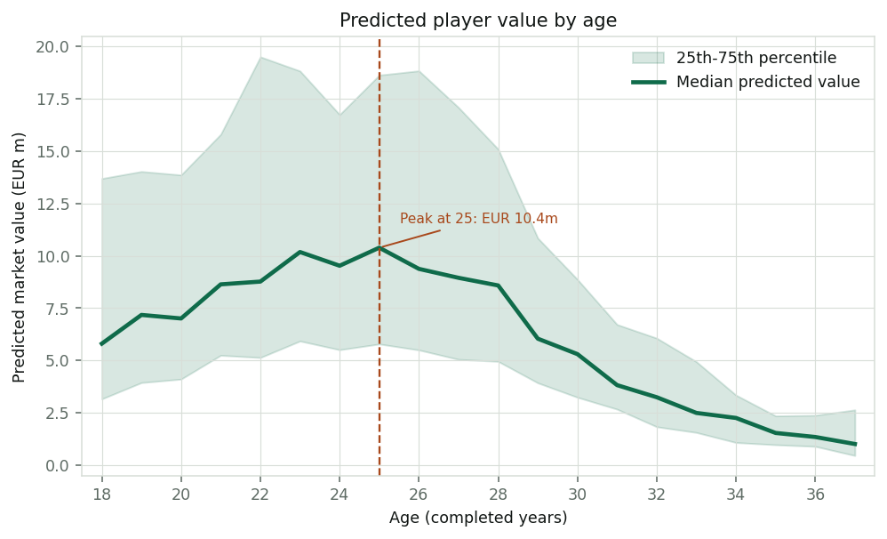

# Player Recruitment & Similarity Tool

Find comparable players across five European leagues, and flag the ones the
market prices below their profile.

**🔗 Live app:** _(deploy to Streamlit Community Cloud and paste the link here — this is the first thing anyone will click)_

<!-- Once you have run `python run_pipeline.py --stage figures`, assets/radar_example.png exists. -->


---

> **⚠️ This README is scaffolded, not finished.** Every number below is a
> placeholder. The validation notebook produces the real ones — fill them in as
> you go, and delete this block when nothing marked `TODO` is left.

---

## Building it (delete this section when you're done)

The plumbing is written. The modelling and the product are not — those modules
are signatures, docstrings and numbered `TODO`s, and the test suite is the spec.

```bash
pytest -q          # 17 pass (config + plumbing), 30 are waiting for you
```

Every failure names the exact function to write. Work in this order, because
each stage feeds the next:

| # | Module | What you're building | Tests it turns green |
| --- | --- | --- | --- |
| 1 | `src/name_matching.py` | Normalise → block → fuzzy → override | `test_smoke.py -k "normalise or season"` |
| 2 | `src/features.py` | Per-90, possession adjustment, percentiles | `-k "possession or resolve"`, then the synthetic feature tests |
| 3 | `src/similarity.py` | PCA component choice, cosine kNN | the similarity block in `test_pipeline_synthetic.py` |
| 4 | `src/value_model.py` | Log target, GroupKFold, OOF residuals | the value block |
| 5 | `src/radar.py` + `app.py` | The product layer | none — judge it by eye |
| 6 | `src/figures.py` | README figures | `test_every_readme_figure_renders` |

Two things to know about the test suite:

- **`tests/test_pipeline_synthetic.py` runs the whole chain on generated data,
  no network.** You do not need the 2-hour FBref scrape to find out whether your
  PCA and kNN agree on their index. Run it constantly.
- **The index-alignment tests are the valuable ones.**
  `test_comparables_stay_inside_their_position_group` and
  `test_neighbours_exclude_self_and_rank_from_one` catch the classic bug here:
  `kneighbors` returns positional indices into the matrix you fitted, not player
  ids, and conflating the two produces comps that look plausible and are wrong.

`streamlit run app.py` works from the start — the page renders a skeleton with
each unbuilt section marked, so you can fill them in one at a time.

---

## The brief

> _A mid-table Premier League side has lost its first-choice left-back. They
> need a replacement under 23, a budget of €8m, and the same profile: high
> volume overlapping runs, crossing from the byline rather than inverting into
> midfield._

**TODO — this case study is the centrepiece of the project.** Work the brief
with your own tool and write it up here, with screenshots:

1. The filter state you set, and why those filters and not others.
2. The comparables the model returned.
3. **The ones you discarded, and why.** This is the part that matters. Anyone
   can screenshot a top-five list; explaining that the second-ranked option is
   wrong — wrong foot, contract to 2030, profile match driven by a stat that
   flatters him in a low block — is what shows you understand both football and
   your own model's limits.
4. What you would actually send to a scout.

---

## What it does

| | |
| --- | --- |
| **Comparables** | Cosine nearest-neighbours on PCA style scores, within position group |
| **Style profile** | Percentile radar against players in the same group and season |
| **Value flag** | Residual from an expected-market-value model, as a multiple |
| **Filters** | Position group, season, league, age range, budget ceiling, minimum minutes |

### Two decisions worth defending

**Cosine, not Euclidean.** On standardised PCA scores, cosine distance compares
the *shape* of a profile and largely ignores its magnitude — which is what
"plays like him" means. Euclidean blends style with level, so it returns the
same handful of elite players as comparables for everybody.

**Search in PCA space, plot in UMAP space.** The app's style map is UMAP
because it produces a far more readable scatter. The neighbour search is never
run there: UMAP deliberately distorts global distances to preserve local
structure, so distances between distant points carry no meaning and shift when
you refit. The app labels the map as a picture, not as the model.

---

## How it works

### Data

| Source | Via | What it gives |
| --- | --- | --- |
| [FBref](https://fbref.com) | [`soccerdata`](https://soccerdata.readthedocs.io/) | Per-90 stats across eight stat pages |
| [transfermarkt-datasets](https://github.com/dcaribou/transfermarkt-datasets) | direct CSV download | Market values, `sub_position`, contract expiry |

No live scraping of Transfermarkt. The project uses dcaribou's already-scraped,
versioned release, which is both kinder to the site and far more reproducible —
anyone cloning this repo gets the same bytes.

Two Transfermarkt fields justify the detour on their own:

- **`sub_position`** — "Centre-Back", "Left-Back", "Defensive Midfield". FBref's
  own position column gives only `DF` / `MF` / `FW`, which cannot separate a
  centre-back from a full-back — exactly the distinction this tool exists to
  respect.
- **`contract_expiration_date`** — contract years remaining is one of the
  strongest real drivers of transfer price, and is absent from most portfolio
  versions of this project.

`soccerdata` 1.9.0 only exposes five player-season stat types, which leaves out
`passing`, `defense`, `possession` and `gca` — between them almost everything
describing *how* a player plays rather than how much he scores.
[`src/fbref_extra.py`](src/fbref_extra.py) subclasses the reader to widen it,
reusing its caching and rate limiting.

### Position groups

Seven groups: `CB`, `FB`, `DM`, `CM`, `AM`, `W`, `ST`. Each has its own feature
set of 12–18 per-90 stats — comparing a striker to a full-back on the same axes
is the single most common way a tool like this becomes useless.

Goalkeepers are deliberately out of scope. Their stat profile shares almost
nothing with outfield players and would need its own features, PCA and value
model.

### Two adjustments that are easy to skip

- **Possession adjustment.** A midfielder at a team with 65% of the ball makes
  fewer tackles because the ball is not there to be won. Defensive per-90s are
  scaled to a neutral 50% baseline. Without this, a "best defensive midfielder"
  ranking is really a ranking of players at bad teams.
- **Volume separated from efficiency.** Both an attempt rate and a success rate
  for dribbling, passing and aerials. Style lives in the gap between them: two
  wingers with identical completed dribbles per 90 are very different players if
  one attempts twice as many.

### Style dimensions

**TODO** — read `reports/pca_loadings.csv` (section 3 of the notebook) and name
the first three components per group in plain football language.

| Group | PC1 | PC2 | PC3 |
| --- | --- | --- | --- |
| CB | _TODO_ | _TODO_ | _TODO_ |
| FB | _TODO_ | _TODO_ | _TODO_ |
| DM | _TODO_ | _TODO_ | _TODO_ |
| CM | _TODO_ | _TODO_ | _TODO_ |
| AM | _TODO_ | _TODO_ | _TODO_ |
| W | _TODO_ | _TODO_ | _TODO_ |
| ST | _TODO_ | _TODO_ | _TODO_ |


### Value model

Fitted on `log(market value)`, because values span roughly €100k to €180m and
are close to log-normal. On raw euros the loss is dominated by a handful of
superstars and every prediction under €5m becomes noise — exactly the range
recruitment cares about.

Inputs: age (splined — value peaks in the mid-twenties and a linear term cannot
represent that), minutes, contract years remaining, league, position group,
season, and a universal set of thirteen per-90 stats.

Cross-validated with `GroupKFold` **grouped by player**. The same player appears
in several seasons, and plain `KFold` lets his 2023-24 row train a model that
predicts his 2024-25 row — which inflates R² into fiction.

The shortlist is built from **out-of-fold** predictions. In-sample predictions
would shrink every residual toward zero and hide exactly the players the tool
exists to surface.



The ageing curve above is recovered from the data — nobody told the model that
value peaks in the mid-twenties.


---

## Validation

**TODO — fill from `notebooks/validation.ipynb`.** These are the numbers that
separate a tool somebody might trust from a notebook that produced a plot.

| Claim | Value |
| --- | --- |
| Player-seasons in the sample | _TODO_ |
| Leagues × seasons | 5 × 3 |
| Name match rate (FBref → Transfermarkt) | _TODO_% |
| Median rank of a player's own adjacent season | _TODO_ |
| Share of players whose own other season ranks top-5 | _TODO_% |
| Value model median absolute error (CV, grouped by player) | _TODO_% |
| Smallest position group | _TODO_ players |

### Self-consistency

The one similarity metric here that is not a matter of taste: the same player in
an adjacent season should rank very high in his own neighbour list. A low median
rank is quantitative evidence that the embedding captured the player rather than
the noise.

### The eye test

**TODO** — your verdict on five players you know well, including **at least one
miss, explained**. A README where every comp is perfect reads as unexamined.

### Known transfers

**TODO** — replacement signings clubs actually made, and whether the model would
have surfaced the replacement as a comparable to the departing player.

---

## Limitations

Stated here rather than waiting for someone else to point them out.

- **Transfermarkt values are crowd-sourced estimates, not transfer fees.** The
  model predicts *the crowd's valuation*. A negative residual means "cheaper
  than his profile suggests the market should rate him" — not "worth more than
  he costs".
- **Residuals skew toward cheaper leagues by construction**, because league is a
  feature. Read the shortlist inside a league and budget filter; the app's
  filters exist for exactly this reason.
- **Some players are cheap for reasons no dataset holds** — injuries, attitude, a
  visa, a release clause. This tool produces a shortlist to scout, not a decision
  to sign.
- **No minutes-by-position data.** A player who spent half a season at left-back
  and half in midfield gets one position group and one set of axes.
- **Season-level data only.** No match-to-match form, no opponent adjustment, no
  in-possession phase splits.
- **Upstream data is frozen.** `transfermarkt-datasets` paused updates: values
  stop at 2026-06-12 and 2026/27 squads are not covered, so 2025-26 is the newest
  usable season.
  ([status](https://github.com/dcaribou/transfermarkt-datasets/discussions/383))
- **Goalkeepers are excluded.**
- **The name join is imperfect.** See the match rate above; unmatched players
  fall back to FBref's coarse position column and are flagged in the app.

---

## Reproduce it

```bash
git clone <your-repo-url>
cd player-recruitment-tool

python -m venv .venv
.venv\Scripts\activate          # Windows
# source .venv/bin/activate     # macOS / Linux

pip install -r requirements.txt
```

Then run the pipeline. Stages are ordered, and each skips itself if its output
already exists, so a re-run after a crash resumes rather than restarting:

```bash
python run_pipeline.py --stage all
```

```bash
streamlit run app.py
```

### Stages

| Stage | Cold-start time | What it does |
| --- | --- | --- |
| `fetch-fbref` | 60–120 min | Rate-limited to ~1 request / 3s. Cached under `~/soccerdata`. |
| `fetch-transfermarkt` | 3–10 min | One ~241 MB download |
| `merge` | 1–3 min | The fuzzy name join dominates |
| `features` | < 1 min | Per-90, possession-adjust, percentile-rank |
| `similarity` | 1–2 min | PCA + cosine kNN per group; UMAP is the slow part |
| `value` | 1–3 min | Cross-validation across two candidate models |
| `figures` | < 1 min | Rebuilds `assets/` |

Only `fetch-fbref` is genuinely expensive, and because `soccerdata` caches the
raw HTML, a second cold start is far quicker than the first.

```bash
python run_pipeline.py --list
python run_pipeline.py --stage features --force
python run_pipeline.py --stage all --from-stage merge
```

If FBref changes a table header and a feature stops resolving:

```bash
python run_pipeline.py --stage inspect-columns
```

That writes every column name actually returned to `reports/fbref_columns.txt`.
Fix the patterns in `src/config.py`, then re-run `--stage features --force`.

```bash
pytest -q
```

The test suite runs on a clean clone with no data — it catches config drift
(a feature listed in a position group but missing from the registry, a season
key that parses to the wrong year) before you spend an hour on a pipeline run.

---

## Repo layout

```
.
├── app.py                      Streamlit entry point - reads only, never fits
├── run_pipeline.py             Stage runner; reproduces every artefact
├── requirements.txt
├── .streamlit/config.toml      App theme
├── src/
│   ├── config.py               EVERY tunable choice lives here
│   ├── paths.py                Single source of truth for file locations
│   ├── fbref_extra.py          Widened FBref reader (passing/defense/possession)
│   ├── fetch_fbref.py          Stage 1a
│   ├── fetch_transfermarkt.py  Stage 1b
│   ├── name_matching.py        Normalise -> block -> fuzzy -> manual override
│   ├── merge.py                Stage 2: one player-season table
│   ├── features.py             Stage 3: per-90, possession-adjust, percentiles
│   ├── similarity.py           Stage 4: PCA + cosine kNN per group
│   ├── value_model.py          Stage 5: expected value, undervalued shortlist
│   ├── radar.py                Plotly charts for the app
│   └── figures.py              Stage 6: matplotlib figures for this README
├── data/
│   ├── raw/                    gitignored - reproducible downloads
│   ├── interim/                gitignored
│   ├── processed/              COMMITTED - the deployed app reads these
│   └── manual_name_overrides.csv
├── artifacts/                  COMMITTED - fitted models (joblib)
├── reports/                    COMMITTED - evidence the pipeline behaved
├── notebooks/validation.ipynb  Sanity checks against players you know
├── assets/                     Figures for this README
└── tests/test_smoke.py
```

### Why `data/processed/` and `artifacts/` are committed

Streamlit Community Cloud has no way to run the pipeline, so the app has to
read artefacts that are already in the repo. They are small — keep them that
way by dropping unused columns before writing. GitHub rejects single files over
100 MB; if a parquet file starts approaching that, trim columns rather than
reaching for Git LFS.

---

## Deployment notes

- Community Cloud installs from `requirements.txt` at the repo root. An
  unpinned dependency resolving differently on the server than on your machine
  is the classic first failed deploy — run `pip freeze > requirements.lock.txt`
  from a clean venv before you deploy.
- **Check which Python versions Community Cloud offers before building your
  venv.** Discovering a mismatch at deploy time means re-resolving every pin.
- Deploy an early, near-empty version on day one, so the pipeline is already
  proven by the time the real app is ready.
- The app loads only the columns it needs and keeps position-group matrices
  separate rather than one wide frame, to stay inside the memory ceiling.

---

## Credits

- Stats: [FBref](https://fbref.com) via
  [`soccerdata`](https://github.com/probberechts/soccerdata) by Pieter Robberechts
- Market values:
  [`transfermarkt-datasets`](https://github.com/dcaribou/transfermarkt-datasets)
  by David Cariboo
